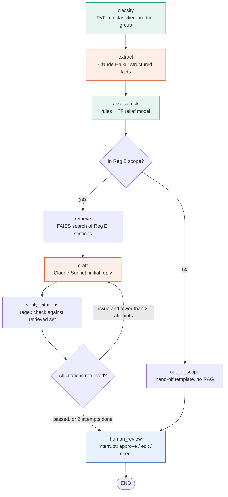

# complaint-triage

Triage of consumer complaints about electronic fund transfers (Regulation E) for a US retail bank. For each complaint the system classifies the product line, extracts the facts that determine regulatory deadlines and liability, flags complaints that need priority handling, retrieves the applicable Regulation E sections, and drafts an initial reply that cites them. Every draft must be approved, edited or rejected by a complaint analyst; the system never sends anything to a customer.

Built with LangGraph and LangChain, PyTorch and Hugging Face Transformers, TensorFlow/Keras, and MLflow.

Full requirements, business process, workflow and system design: [docs/design.md](docs/design.md).

## Contents

- [Scope](#scope)
- [Architecture](#architecture)
- [Repository layout](#repository-layout)
- [Data sources](#data-sources)
- [Prerequisites](#prerequisites)
- [Installation](#installation)
- [Configuration](#configuration)
- [Smoke test](#smoke-test)
- [Full pipeline](#full-pipeline)
- [Human review](#human-review)
- [Evaluation](#evaluation)
- [Implementation map](#implementation-map)
- [Operational notes](#operational-notes)
- [Known limitations](#known-limitations)
- [Troubleshooting](#troubleshooting)
- [Disclaimer](#disclaimer)

## Scope

In scope (v1):

- Complaints in two product groups governed by Regulation E (12 CFR Part 1005): *Checking or savings account* and *Money transfer or service*.
- Classification into nine product groups, structured fact extraction, rule- and model-based escalation, retrieval of Regulation E sections, a cited initial reply, a programmatic citation check, and mandatory human review.
- Experiment tracking, model registry, alias-based promotion and model serving with MLflow.

Out of scope (v1): sending replies, computing Regulation E deadlines, account postings such as provisional credit, regulations other than Regulation E, integration with bank systems, a graphical interface, and authentication. Complaints outside Regulation E receive a hand-off template and are routed to the responsible team.

## Architecture

One stateful LangGraph graph processes each complaint. Two nodes call models trained in this repository, two call an LLM, and the rest are deterministic logic. The graph pauses at `human_review` and resumes from a SQLite checkpoint.



*Orange: calls Claude. Green: calls a model trained in this repository. Blue: human review.*

| Component | Technology | Role |
| --- | --- | --- |
| Product classifier | PyTorch, Hugging Face Transformers (fine-tuned DistilBERT) | Assigns one of nine product groups; decides whether the Regulation E path applies |
| Relief model | TensorFlow / Keras MLP | Estimates the probability that a complaint closes with monetary relief; one of the escalation signals |
| Retrieval | sentence-transformers (BAAI/bge-small-en-v1.5), FAISS through LangChain | Finds the Regulation E sections relevant to a complaint |
| Extraction and drafting | Claude Haiku and Claude Sonnet through LangChain, Pydantic structured output | Extracts facts; drafts an initial reply that cites only retrieved sections |
| Orchestration | LangGraph `StateGraph`, `SqliteSaver`, `interrupt()` | Routing, the bounded redraft loop, and the resumable review pause |
| MLOps | MLflow tracking, model registry, `mlflow models serve` | Run tracking, versioning, `champion` alias, HTTP serving |

To print the graph as Mermaid: `python -m triage.graph`.

## Repository layout

```
complaint-triage/
├── config.yaml                  # All parameters: model names, paths, thresholds, serving backends
├── config.smoke.yaml            # Smoke-test configuration: synthetic data, tiny random models, CPU
├── requirements.txt             # Main environment: torch, transformers, langchain, langgraph, mlflow
├── requirements-tf.txt          # TensorFlow environment: tensorflow, mlflow
├── .env.example                 # Template for ANTHROPIC_API_KEY and MLFLOW_TRACKING_URI
├── docs/
│   └── design.md                # Requirements, workflow and system design
├── triage/                      # Python package
│   ├── config.py                # Loads the configuration and resolves paths
│   ├── taxonomy.py              # Nine product groups; Regulation E scope
│   ├── data_io.py               # Field normalization, cleaning, balanced sampling, stratified split
│   ├── reg_e.py                 # eCFR download, XML parsing, section chunking, citation regex
│   ├── retrieval.py             # Hugging Face embeddings and FAISS retriever
│   ├── features.py              # Relief-model features shared by training and inference (numpy/pandas only)
│   ├── tracking.py              # MLflow helpers: model URI resolution, champion alias
│   ├── models.py                # Classifier and relief-model clients (local or http)
│   ├── schemas.py               # Pydantic schemas: Extraction, DraftResponse
│   ├── prompts.py               # System prompts for extraction and drafting
│   ├── llm.py                   # ChatAnthropic factory and offline fake LLM
│   ├── nodes.py                 # Graph state, nodes and routing functions
│   ├── graph.py                 # Graph assembly with the SQLite checkpointer
│   ├── synthetic.py             # Synthetic complaints (smoke test only)
│   └── smoke.py                 # Tiny random models (smoke test only)
├── scripts/
│   ├── 00_start_mlflow.sh       # Starts the MLflow tracking server
│   ├── 01_download_cfpb.py      # Dataset from the CFPB API or a CSV export; synthetic data for the smoke test
│   ├── 01b_load_parquet_snapshot.py  # Dataset from a Parquet snapshot of the complaint database
│   ├── 02_fetch_reg_e.py        # eCFR → reg_e_chunks.jsonl
│   ├── 03_embed_and_index.py    # FAISS index and complaint embeddings (.npy)
│   ├── 04_train_classifier.py   # PyTorch + Hugging Face Trainer + MLflow   [main environment, GPU]
│   ├── 05_train_relief_tf.py    # TensorFlow/Keras + MLflow                 [TensorFlow environment]
│   ├── 06_evaluate.py           # Evaluation, champion promotion, report
│   ├── 07_serve_models.sh       # mlflow models serve for either model
│   ├── 08_demo.py               # End-to-end run of the graph with human review
│   └── run_smoke.sh             # Smoke test (bash)
├── evals/retrieval_questions.jsonl   # 25 retrieval questions with expected sections
├── data/fixtures/reg_e_fixture.xml   # eCFR-structured sample for offline tests (paraphrased, not regulation text)
└── reports/                     # Evaluation reports
```

## Data sources

| Source | Use in the system |
| --- | --- |
| CFPB Consumer Complaint Database, Parquet snapshot taken around January 2026 ([Hugging Face: Mouwiya/cfpb-consumer-complaints](https://huggingface.co/datasets/Mouwiya/cfpb-consumer-complaints)) | Training and evaluation data for the classifier and the relief model. Not part of the retrieval index. |
| Regulation E, 12 CFR Part 1005, from the eCFR Versioner API, pulled by date | Embedded in the retrieval index (chunked by section); cited in draft replies. |
| `evals/retrieval_questions.jsonl` | Retrieval evaluation only (recall@5). |
| `data/fixtures/reg_e_fixture.xml` | Offline smoke test only. Paraphrased sample in eCFR structure; not regulation text. |

The CFPB announced on 14 August 2026 that it would stop publishing consumer complaint narratives. The live search API and the current CSV export therefore no longer contain narrative text, so a snapshot taken before that date is required for training. `scripts/01b_load_parquet_snapshot.py` accepts any Parquet export with a narrative, product and company-response column.

## Prerequisites

- Python 3.11 or later. Verified with Python 3.13 on Windows (TensorFlow 2.21).
- Optional NVIDIA GPU with CUDA for classifier training and embeddings. The TensorFlow model trains on CPU.
- An Anthropic API key for full runs. The smoke test does not need one.
- Git, and the Hugging Face CLI (`hf`, installed with `huggingface_hub`) to download the data snapshot.

## Installation

PyTorch and TensorFlow are installed in separate virtual environments to avoid dependency conflicts. The modules shared by both environments (`triage/config.py`, `triage/features.py`, `triage/tracking.py`) import neither framework.

**Linux / macOS (bash)**

```bash
# Main environment
python -m venv .venv && source .venv/bin/activate
pip install --upgrade pip
pip install torch --index-url https://download.pytorch.org/whl/cu128   # choose the CUDA build at pytorch.org
pip install -r requirements.txt
python -c "import torch; print(torch.cuda.is_available())"

# TensorFlow environment
python -m venv .venv-tf
.venv-tf/bin/pip install -r requirements-tf.txt

# Credentials
cp .env.example .env    # then set ANTHROPIC_API_KEY
```

**Windows (PowerShell)**

```powershell
Set-ExecutionPolicy -Scope CurrentUser RemoteSigned   # once, to allow venv activation scripts

# Main environment
python -m venv .venv
.\.venv\Scripts\Activate.ps1
python -m pip install --upgrade pip
pip install torch --index-url https://download.pytorch.org/whl/cu128
pip install -r requirements.txt
python -c "import torch; print(torch.cuda.is_available())"

# TensorFlow environment
python -m venv .venv-tf
.\.venv-tf\Scripts\pip.exe install -r requirements-tf.txt

# Credentials
Copy-Item .env.example .env   # then set ANTHROPIC_API_KEY
```

On Windows, set `PYTHONUTF8=1` so that files are read and written as UTF-8. To keep caches off the system drive, set `HF_HOME` and `PIP_CACHE_DIR` before installing.

## Configuration

All parameters are in `config.yaml`. Set `TRIAGE_CONFIG` to use another file (for example `config.smoke.yaml`).

| Section | Contents |
| --- | --- |
| `mlflow` | Tracking URI and experiment name |
| `paths` | Data, index, checkpoint and report locations |
| `data` | Date filter, samples per product group, test share, seed |
| `embedding` | Embedding model and batch size |
| `classifier` | Base model, registered name, sequence length, training parameters |
| `relief` | Network size, training parameters, escalation threshold |
| `llm` | Extraction and drafting models, `temperature`, `max_tokens`, structured-output method |
| `serving` | `local` or `http` for the classifier; `disabled` or `http` for the relief model; service URLs |
| `retrieval` | Number of retrieved chunks, chunk size |
| `risk` | Amount threshold and customer tags that trigger escalation |
| `graph` | Maximum number of draft attempts |

| Environment variable | Effect |
| --- | --- |
| `ANTHROPIC_API_KEY` | Required for real LLM calls (read from `.env`) |
| `MLFLOW_TRACKING_URI` | Overrides the tracking URI in the configuration |
| `TRIAGE_CONFIG` | Path to the configuration file |
| `TRIAGE_FAKE_LLM=1` | Replaces both LLM nodes with deterministic offline output |

## Smoke test

The smoke test runs every script and the graph on synthetic data with tiny randomly initialized models and a fake LLM. It needs no network access, GPU or API key and completes in about five minutes. Metrics from this run are not meaningful; it verifies code paths only.

Start the MLflow server in a separate terminal first (step 1 of [Full pipeline](#full-pipeline)).

**bash**

```bash
bash scripts/run_smoke.sh      # TF_PYTHON defaults to .venv-tf/bin/python
```

**PowerShell**

```powershell
$env:TRIAGE_CONFIG = "config.smoke.yaml"; $env:TRIAGE_FAKE_LLM = "1"
python scripts/01_download_cfpb.py --synthetic
python scripts/02_fetch_reg_e.py
python scripts/03_embed_and_index.py
python scripts/04_train_classifier.py
.\.venv-tf\Scripts\python.exe scripts/05_train_relief_tf.py
python scripts/06_evaluate.py
python scripts/08_demo.py --auto-approve --product-group "Checking or savings account" --text 'Someone used my debit card for $800 in ATM withdrawals I did not authorize. I reported it two days later and the bank refused a refund.'
Remove-Item Env:TRIAGE_CONFIG; Remove-Item Env:TRIAGE_FAKE_LLM
```

The MLflow UI at http://127.0.0.1:5000 then shows the `complaint-triage-smoke` experiment with classifier, relief and evaluation runs, and two registered models.

## Full pipeline

Run all commands from the repository root with the main environment active. Commands for the TensorFlow environment are marked; on Windows use `.\.venv-tf\Scripts\python.exe` in place of `.venv-tf/bin/python`.

| Step | Script | Output |
| --- | --- | --- |
| 1 | MLflow server | Tracking server on port 5000 |
| 2 | `01b_load_parquet_snapshot.py` | Balanced train/test Parquet files, 9 groups × 1,000 complaints |
| 3 | `02_fetch_reg_e.py` | Regulation E chunks |
| 4 | `03_embed_and_index.py` | FAISS index; complaint embeddings |
| 5 | `04_train_classifier.py` | New `complaint-classifier` version |
| 6 | `05_train_relief_tf.py` | New `relief-predictor` version |
| 7 | `06_evaluate.py` | `reports/eval_report.md`; `champion` aliases |
| 8 | `07_serve_models.sh` | Model services on ports 5001 and 5002 |
| 9 | `08_demo.py` | End-to-end run with human review |

**1. Start the MLflow tracking server** (keep this terminal open)

```bash
bash scripts/00_start_mlflow.sh
# PowerShell:
# mlflow server --backend-store-uri sqlite:///mlflow.db --artifacts-destination ./mlruns --host 127.0.0.1 --port 5000
```

**2. Build the dataset from the complaint snapshot**

```bash
hf download Mouwiya/cfpb-consumer-complaints --repo-type dataset --local-dir ../cfpb_parquet
python scripts/01b_load_parquet_snapshot.py --parquet-dir ../cfpb_parquet
```

**3–6. Regulation E corpus, embeddings and models**

```bash
python scripts/02_fetch_reg_e.py                 # optional: --date YYYY-MM-DD for a point-in-time version
python scripts/03_embed_and_index.py
python scripts/04_train_classifier.py
.venv-tf/bin/python scripts/05_train_relief_tf.py   # TensorFlow environment
```

**7. Evaluate and promote**

```bash
python scripts/06_evaluate.py
```

**8. Serve both models** (one terminal each, `MLFLOW_TRACKING_URI` set to `http://127.0.0.1:5000`)

```bash
bash scripts/07_serve_models.sh classifier       # main environment, port 5001
bash scripts/07_serve_models.sh relief           # TensorFlow environment, port 5002
```

```powershell
# PowerShell equivalents
mlflow models serve -m "models:/complaint-classifier@champion" -p 5001 --host 127.0.0.1 --env-manager local   # main environment
mlflow models serve -m "models:/relief-predictor@champion" -p 5002 --host 127.0.0.1 --env-manager local       # TensorFlow environment
```

Then set both backends to HTTP in `config.yaml`:

```yaml
serving:
  classifier_backend: http
  relief_backend: http
```

**9. Run the graph end to end**

```bash
python scripts/08_demo.py                       # first in-scope complaint in the test set
python scripts/08_demo.py --index 12            # a specific test-set row
python scripts/08_demo.py --text "..." --tags "Older American"
python scripts/08_demo.py --product-group "Checking or savings account"   # bypass the classifier
python scripts/08_demo.py --auto-approve        # non-interactive
python scripts/08_demo.py --thread my-run-1     # reuse a thread id
```

Step 9 can also run before step 8 with the default configuration (`classifier_backend: local`, `relief_backend: disabled`), which loads the classifier in-process and skips the relief model.

## Human review

`08_demo.py` prints the output of each node and stops at `human_review`, showing the product group, escalation reasons, draft, citations, confidence, reviewer notes and any citation issues. Enter `approve`, `edit` (followed by replacement text) or `reject`. The graph resumes from the SQLite checkpoint (`data/checkpoints.sqlite`) with `Command(resume=...)`; a run interrupted at review can be resumed later with the same `--thread` value.

## Evaluation

`scripts/06_evaluate.py` writes `reports/eval_report.md` and logs an evaluation run to MLflow.

| Component | Metrics | Data |
| --- | --- | --- |
| Classifier | Accuracy, macro-F1, per-group accuracy | Test split; labels from the CFPB product field |
| Retrieval | recall@5 | `evals/retrieval_questions.jsonl` (25 questions) |
| Relief model | PR-AUC, ROC-AUC, precision and recall at the threshold | Test split; label = closed with monetary relief |

Each change to `config.yaml` followed by steps 5–7 produces a new run and a new model version; `06_evaluate.py` assigns the `champion` alias to the version with the best metric. Restart the model services after a promotion: a running `mlflow models serve` process does not reload when the alias moves.

## Implementation map

| Technology | Location | Key constructs |
| --- | --- | --- |
| PyTorch + Hugging Face | `scripts/04_train_classifier.py` | `AutoModelForSequenceClassification`, `Trainer`, `report_to=["mlflow"]`, bf16 |
| Hugging Face embeddings | `triage/retrieval.py`, `scripts/03_embed_and_index.py` | `HuggingFaceEmbeddings(BAAI/bge-small-en-v1.5)` |
| TensorFlow | `scripts/05_train_relief_tf.py` | Keras functional model, `class_weight`, PR-AUC, `EarlyStopping` |
| MLflow | `triage/tracking.py`, `scripts/04`–`07` | `log_params` / `log_metrics`, `log_model(registered_model_name=, model_config=)`, `set_registered_model_alias`, `models:/name@champion`, `mlflow models serve` |
| LangChain | `triage/llm.py`, `triage/retrieval.py`, `triage/nodes.py` | `ChatAnthropic.with_structured_output(..., method="json_schema")`, `FAISS.as_retriever()` |
| LangGraph | `triage/nodes.py`, `triage/graph.py` | `StateGraph` with a TypedDict state, `Annotated[list, operator.add]` reducer, conditional edges, redraft loop, `SqliteSaver`, `interrupt()` / `Command(resume=)` |

## Operational notes

- **LLM settings.** Claude 5.x models do not accept `temperature`, so `llm.temperature` is `null` and the parameter is not sent. Model thinking counts toward `max_tokens`, which is set to 4096 so structured output is not truncated. Structured output uses the native `json_schema` method.
- **Input length.** The classifier is logged with `model_config={"truncation": True, "max_length": max_len}`, so MLflow truncates long complaints at inference in every serving mode.
- **Citation normalization.** Section references are normalized to `1005.x` before the citation check, so `§ 1005.6` and `1005.6` compare equal.
- **Cost.** Extraction uses Claude Haiku and drafting uses Claude Sonnet; one complaint costs approximately USD 0.01–0.02 in API usage. Training and embedding run locally.

## Known limitations

- Only Regulation E is covered; other product groups receive a hand-off template.
- Prepaid card complaints are grouped with credit cards and therefore take the out-of-scope path, although prepaid accounts are covered by Regulation E.
- Retrieval is vector-only, without BM25 or a reranker.
- `verify_citations` confirms that each cited section was retrieved, not that it supports the draft.
- Regulation E deadlines are not computed; only the facts needed to compute them are extracted.
- The relief label is not causally linked to the reply and serves only as a priority signal.
- Training data comes from complaints submitted to the CFPB and may differ from complaints received through a bank's own channels.
- Model services have no authentication or rate limiting and must stay on localhost.

## Troubleshooting

| Symptom | Resolution |
| --- | --- |
| `Activate.ps1` cannot be loaded | Run `Set-ExecutionPolicy -Scope CurrentUser RemoteSigned` once. |
| `torch.cuda.is_available()` returns `False` | Update the NVIDIA driver or install the PyTorch build that matches it. Training falls back to CPU. |
| TensorFlow import errors | Use the TensorFlow environment's Python for `05_train_relief_tf.py` and for serving the relief model. |
| `mlflow server` or `mlflow models serve` fails on Windows | `pip install waitress`. |
| `Usecols do not match columns` in `01_download_cfpb.py --from-csv` | The current CSV export has no narrative column. Use `01b_load_parquet_snapshot.py` with a snapshot. |
| `02_fetch_reg_e.py` returns 404 | Pass an earlier `--date`. |
| `02_fetch_reg_e.py` reports 0 sections | The eCFR XML structure has changed; check the `N` attribute of `DIV8` elements against `N_RE` in `triage/reg_e.py`. |
| `400 temperature: Extra inputs are not permitted` | Set `llm.temperature: null` in the configuration. |
| `Field required` validation error from the drafting node | Increase `llm.max_tokens`; check that `structured_output_method` is `json_schema`. |
| `size of tensor a ... must match ... (512)` | The registered classifier lacks the truncation `model_config`. Retrain with `04_train_classifier.py` and promote the new version. |
| `mlflow models serve` reports a missing `torchvision` | `04_train_classifier.py` passes explicit `pip_requirements`; keep them if `log_model` is changed. |
| Start from a clean state | Delete `data/processed`, `data/index`, `data/checkpoints.sqlite`, `mlflow.db` and `mlruns/`. |

## Disclaimer

This repository is a reference implementation built on public data. It is not affiliated with the CFPB or with any financial institution, and nothing in it is legal advice. The regulatory summaries in `docs/design.md` are paraphrases; the regulation text and its official interpretations govern.
