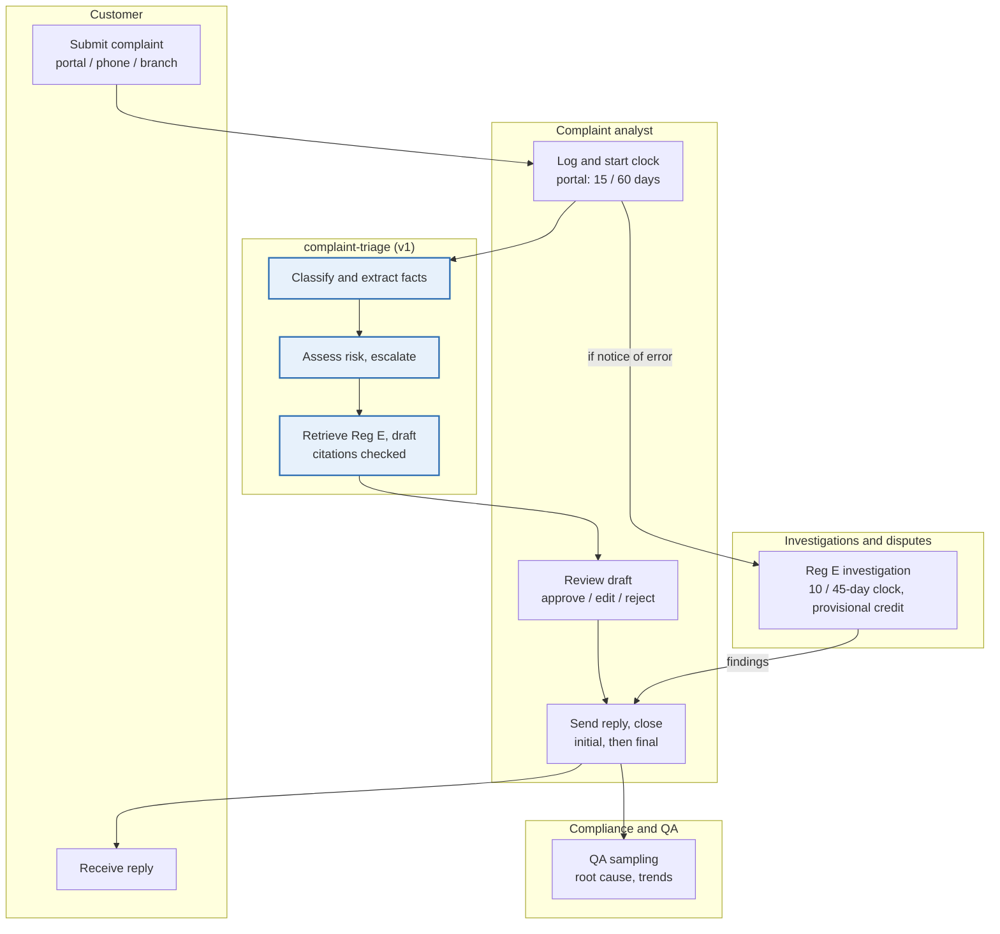
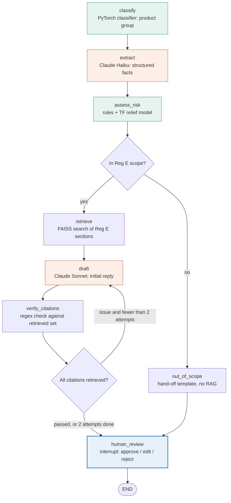
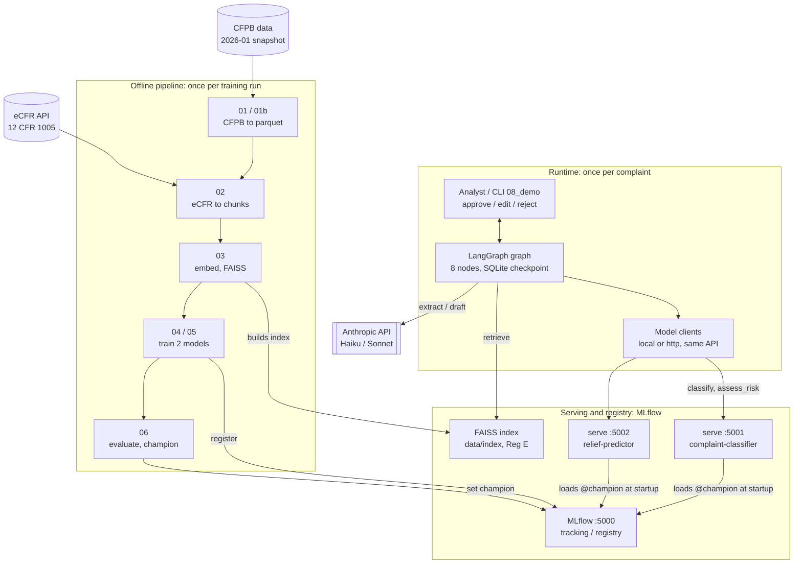

# Bank Complaint Triage System (complaint-triage): Requirements · Workflow · System Design

Last updated: 2026-11-13

## Overview

complaint-triage serves the customer complaint team of a US retail bank. It reads the complaint text, decides which product line it belongs to, extracts the key facts, flags complaints that need priority handling, looks up the applicable Regulation E sections, and drafts an initial reply that cites them. Every reply becomes final only after a complaint analyst approves, edits or rejects it; the system never sends anything to a customer.

v1 focuses on electronic fund transfer complaints: debit card, ATM, ACH debits, P2P transfers and remittances. These are governed by Reg E, whose rules are the strictest: a complaint describing an "unauthorized debit" can itself be a legal notice of error, and the bank must investigate on a business-day clock from the day it receives it. Missing the clock is a violation.

The document has three parts:

- **Requirements**: industry context, business rules, problems to solve, business goals, functional and non-functional requirements.
- **Workflow**: how a complaint moves through the bank from submission to closure and which steps the system takes over; how one complaint flows inside the system; how models are trained, served and replaced.
- **System design**: architecture, data, models, orchestration, MLOps, evaluation, governance and evolution.

What each source is used for, and whether it enters the system:

| Source | Role in the system |
| --- | --- |
| Reg E text (12 CFR Part 1005 sections, pulled from eCFR by date) | **Embedded in the RAG knowledge base**: chunked by section, embedded, retrieved at run time and cited in draft replies |
| Reg E official interpretations (Supplement I); CFPB description of the company complaint process | **Basis for business rules only**: the deadlines and liability rules in 1.1 and 1.2 come from these; not loaded into the system |
| CFPB Consumer Complaint Database (2026-01 Parquet snapshot) | **Training and evaluation data**: trains the classifier and the relief model, builds the test set; not in the knowledge base |
| Retrieval evaluation set (25 questions → expected sections) | **Evaluation data**: used only to compute retrieval recall@5 |

Scope is v1 only, built on LangChain/LangGraph, PyTorch + HuggingFace, TensorFlow and MLflow. Later extensions are in 3.14.

## Part 1 Requirements

Complaint analysts today do four things by hand: read the complaint, classify the product line, look up the regulation, and draft a reply. The system takes over those four steps and leaves people to review, edit and send. The aim is faster, more consistent handling that never misses a Reg E deadline.

### 1.1 Industry and business context

The industry is US retail banking (consumer finance): checking and savings accounts, debit cards, ATMs, P2P transfers and remittances, credit cards, and consumer loans. Complaint management inside a bank is a regulated function: the complaint team in operations handles complaints in the first line, and compliance samples and oversees the work.

Complaints arrive through two kinds of channel: the CFPB complaint portal (the CFPB checks each complaint for completeness and forwards it to the bank), and the bank's own call center, branches, online banking and mail. Portal complaints have fixed deadlines: the bank responds within 15 calendar days; if that response is not final it tells the CFPB and has up to 60 calendar days for a final response; the response covers the steps taken, communications with the consumer, and follow-up actions ([CFPB company process](https://consumerfinance.gov/compliance/consumer-complaint-program/company-process)). Deadlines for other channels are set by bank policy.

Complaints matter to the bank in three ways:

- **They trigger legal obligations**: some complaints are legal notices in themselves. Under Reg E, a complaint describing a transfer error that meets the notice requirements starts the statutory investigation clock (see 1.2).
- **They are examined by regulators**: whether complaints are answered on time, classified consistently and analyzed for root cause is routine examination material.
- **They are early risk signals**: a cluster of complaints about the same product and issue often points to a system defect or bad practice that needs remediation (refunds) and root-cause analysis.

### 1.2 Key business rules: Regulation E

v1 covers only Reg E (12 CFR Part 1005, electronic fund transfers), because its deadlines run in business days and missing one is a violation. It covers debit card transactions, ATMs, ACH debits and P2P transfers; Subpart B covers international remittances. Credit card disputes fall under Regulation Z and are out of scope. The rules below are summarized from [§1005.11](https://www.law.cornell.edu/cfr/text/12/1005.11) and [§1005.6](https://www.law.cornell.edu/cfr/text/12/1005.6).

**What counts as an error**: an unauthorized electronic transfer, a transfer with the wrong amount or destination, a transfer missing from a periodic statement, a computational or bookkeeping error by the bank, receiving the wrong amount from an ATM, and a consumer request for documentation or clarification about a transfer. Balance inquiries, records for tax purposes and requests for duplicate copies are not errors.

**When a notice of error has been received**: the consumer tells the bank orally or in writing, within 60 days after the bank sent the first periodic statement showing the error, in a way that lets the bank identify the name and account, and says why they believe there is an error (with type, date and amount where possible). Three business consequences follow:

- A complaint that meets these conditions may already be a notice of error, and the clock starts on the day the bank receives it.
- Oral notice counts: the bank may ask for written confirmation within 10 business days, but it may not wait for that confirmation before starting the investigation.
- A notice later than 60 days cannot simply be rejected: when an unauthorized transfer is involved, the bank must still apply §1005.6 before holding the customer liable.

**The clock after a notice is received**:

| Event | Deadline | Section |
| --- | --- | --- |
| Determine whether an error occurred | Within 10 business days of the notice | §1005.11(c)(1) |
| Investigation not finished in 10 business days | Up to 45 days, provided the disputed amount is provisionally credited within 10 business days, the customer is told the amount and date within 2 business days, and has full use of the funds during the investigation | §1005.11(c)(2) |
| Transfer within 30 days after the account's first deposit | 10 business days becomes 20; 45 days becomes 90 | §1005.11(c)(3) |
| Transfer initiated outside a state, or POS debit card transaction | 45 days becomes 90 | §1005.11(c)(3) |
| Investigation complete | Report results within 3 business days; if there was an error, correct it within 1 business day | §1005.11(c)(1)(2) |
| No error found | Written explanation, plus notice that the customer may request the documents relied on; reversing a provisional credit requires notice of date and amount, and for 5 business days afterward the bank honors third-party checks and preauthorized transfers without overdraft fees | §1005.11(d) |

**How much the customer bears** (unauthorized transfers):

| Situation | Customer liability limit | Section |
| --- | --- | --- |
| Notice within 2 business days of learning the card was lost or stolen | The lesser of $50 or the unauthorized amount before notice | §1005.6(b)(1) |
| Notice after 2 business days | Up to $500 | §1005.6(b)(2) |
| Unauthorized transfer on a statement, not reported within 60 days of the statement | Transfers after the 60 days and before notice that the bank shows timely notice would have prevented | §1005.6(b)(3) |
| Delay caused by extenuating circumstances | The time limits above are extended to a reasonable period | §1005.6(b)(4) |

These two tables decide what the system must extract and what it must not write. When the customer noticed the problem, when they reported it, and how much was involved decide the investigation deadline and how much the bank pays, so the extraction step must capture the date noticed, the date reported, whether it was reported within 60 days, and the amount. Liability is settled only by the investigation, so the initial reply can explain rules and process but must not promise an outcome. v1 does not compute these clocks; it only extracts the facts needed to compute them. Clock calculation and reminders are on the roadmap.

### 1.3 Problems to solve

Analysts currently read, classify, look up and draft by hand (full process in 2.1). The problems concentrate in five places:

| Problem | Consequence |
| --- | --- |
| Reading is slow: complaints run from a few dozen to over a thousand words, with much that is irrelevant to the request | Backlogs; the 15-day portal deadline gets tight |
| Classification is inconsistent: the same kind of issue is put under different product lines by different people | Wrong routing, distorted trend reports, poor root-cause analysis |
| Notices of error are recognized late: transfer complaints are not identified as Reg E notices at intake | The 10-business-day determination or provisional-credit deadline can be missed, which is a violation |
| High-risk complaints are not prioritized: older customers, servicemembers, large amounts and likely-refund cases queue with everything else | Vulnerable customers are protected late and remediation is slow |
| Reply quality varies: wrong sections cited, wording that sounds like a promise or an admission | Compliance risk and rework |

### 1.4 Business goals and non-goals

Six business goals: the first five answer the five problems in 1.3, the sixth serves compliance sampling and regulatory examination. Values are targets; measured results are in the evaluation report (reports/eval\_report.md).

| Business goal | How it is measured | v1 target |
| --- | --- | --- |
| Analysts no longer start from scratch: the system supplies classification, facts, sections and a first draft; people only review | End-to-end time per complaint; reviewer edit volume | < 30 s per complaint |
| Consistent classification usable for routing and reporting | Product-group macro-F1 | ≥ 0.85 |
| Reg E complaints recognized at intake | Classification accuracy for the two in-scope product groups | ≥ 0.90 each |
| High-risk complaints escalated automatically, with reasons | Escalation rules all applied; relief-model PR-AUC | Rules 100%; PR-AUC above 2× the positive rate |
| Compliant replies: only real, relevant sections; no promises, no admissions | All citations come from retrieved sections; every reply human-reviewed | Citation check 100%; human review 100% |
| Every decision on a complaint is traceable | Per-node log, state snapshots and model versions present | 100% |

Non-goals for v1: sending replies automatically; computing Reg E clocks and reminders; provisional credits, corrections or other account postings; regulations other than Reg E (such as Reg Z for credit cards); integration with the bank's complaint system or core banking; a graphical UI; authentication and permissions. These are in the 3.14 roadmap.

### 1.5 Users and roles

| Role | What they do in the business | What they need from the system | Touchpoint |
| --- | --- | --- | --- |
| Complaint analyst (first-line operations, primary user) | Logs, classifies, drafts and sends replies; closes within deadlines | Classification, facts, escalation reasons, sections, first draft | human\_review node; 08\_demo |
| Investigations and disputes team (e.g. debit card disputes) | Pulls transaction records, decides provisional credit, corrects errors | Extracted amount, dates, transaction type; whether Reg E applies | extraction fields (no direct integration in v1) |
| Compliance and QA | Samples replies, checks deadline compliance, runs root-cause and trend analysis | Consistent classification; traceable citations and decision path | trace; cited\_sections; eCFR date of the Reg E corpus |
| Model risk management | Reviews data, method, performance and limitations of each model | Training data, parameters, metrics, versions, limitations | MLflow; evaluation report |
| Development and operations | Maintains, retrains, deploys | Reproducibility, configurable parameters, offline verification | config.yaml; smoke test |

### 1.6 Functional requirements

Each requirement states its business reason; numbers in the acceptance criteria are targets.

| ID | Requirement | Business reason | Acceptance criteria |
| --- | --- | --- | --- |
| FR-1 | Build a balanced dataset from CFPB complaints: 9 product groups, 1,000 complaints with text per group, received 2023 or later | Complaint volume varies widely across product lines and imbalance biases the model toward large groups; product categories are stable from 2023 | train/test parquet; stratified 80/20 split; reproducible with a fixed seed |
| FR-2 | Pull Reg E text from eCFR by date and chunk it by § section, each chunk tagged with its section number | Replies must cite specific sections; pulling by date guarantees the version in force is cited | All sections parsed; each chunk ≤ 1,200 characters with section metadata; error if 0 sections parsed |
| FR-3 | Fine-tune a Transformer encoder to classify the product group, returning label and confidence | Decides routing and whether the Reg E path applies; keeps reporting consistent | macro-F1 ≥ 0.85; < 1 s per complaint; inputs of any length handled |
| FR-4 | LLM extracts fixed fields: summary, transaction type, amount, date noticed, date reported, reported within 60 days, requested remedy | Amount and dates decide the investigation deadline and the liability limit; the remedy shapes the reply | Passes Pydantic validation; fields not stated in the text are null, never guessed |
| FR-5 | Risk assessment: Older American or Servicemember tag, amount ≥ $1,000, or relief probability ≥ threshold escalates, with reasons listed | Vulnerable customers and large amounts come first; likely refunds reach investigators early | escalate + risk\_reasons; thresholds configurable; rules still apply when the relief model is off |
| FR-6 | Semantic retrieval of Reg E sections, top 5 chunks | Many sections, and customers' wording differs from the regulation's; analysts need to land on the right section | recall@5 ≥ 0.8 on 25 evaluation questions |
| FR-7 | LLM drafts an initial reply: ≤ 200 words, plain language, cites only retrieved sections, no promises, no admissions; includes confidence and notes for the reviewer | An initial reply explains applicable rules, deadlines and missing facts; conclusions wait for the investigation | Passes schema validation; sampled drafts contain no promissory language |
| FR-8 | Citation check: every § 1005.x in the draft must be among the retrieved sections, else redraft, at most 2 times | LLMs can invent sections; citing the wrong regulation to a customer is a compliance incident | Programmatic check; after the limit, the draft goes to review with the issues attached |
| FR-9 | Human review: the flow pauses at a review point, supports approve / edit / reject, and can resume across processes | A written reply to a customer is a regulated communication; a person must own it | Resumable with the same thread\_id; no path bypasses review |
| FR-10 | Product groups outside Reg E get a hand-off template; no retrieval, no drafting | Other product lines are handled by their own teams under their own rules; the system stays in its lane | All 7 out-of-scope groups take out\_of\_scope |
| FR-11 | Training logged to experiment tracking; models registered as versions; champion alias set after evaluation | Model risk management requires each model to trace back to data, parameters and metrics | One run per training with parameters, metrics and model files |
| FR-12 | Both models callable as HTTP services with the same interface as in-process calls | Models and the flow are deployed and upgraded separately | Switching local / http in config needs no code change |
| FR-13 | Evaluation report covering classification, retrieval and relief metrics | Evidence before go-live and before every version change | Markdown report plus MLflow record |
| FR-14 | Whole flow runs offline (synthetic data, tiny random models, fake LLM) | Any change is verified first with no network and no cost | Completes in 5 minutes with no GPU and no API key |

### 1.7 Non-functional requirements

| Category | Requirement | Business reason |
| --- | --- | --- |
| Timeliness | < 30 s end to end per complaint | Same-day triage leaves slack inside the 10-business-day and 15-day deadlines |
| Cost | ≤ $0.02 of LLM cost per complaint; training and embedding on a local GPU | Volume is high; unit cost decides whether the system can be used on every complaint |
| Auditability | Each node appends one trace line; each step's state is checkpointed | Compliance sampling and examinations must be able to reconstruct why a complaint was handled a certain way |
| Explainability | Escalations list readable reasons; every citation traces back to the section text | Reviewers must judge whether the system's reasons hold |
| Reproducibility | Fixed seeds; dependency versions and preprocessing parameters stored with the model; configuration in one file | Model validation must be able to rerun and get the same result |
| Privacy | v1 uses only CFPB public data, already redacted (XXXX masking) | Complaint text is sent to an external LLM API; bank data would need a local model or redaction first |
| Security | Localhost only; model services have no authentication or rate limiting | v1 runs on a single workstation; production deployment requires a separate security design |
| Environment | Windows and Linux; falls back to CPU when no GPU is present | Runs on both developer machines and servers |

### 1.8 Data requirements

Complaint records are normalized to one canonical schema, whether they come from the API, the CSV or a Parquet snapshot:

| Field | Business meaning | Used for |
| --- | --- | --- |
| complaint\_id | Complaint number | De-duplication, review records |
| date\_received | Date the CFPB received it | Time filter (from 2023-01-01) |
| product / sub\_product / issue / sub\_issue | Product and issue categories chosen by the consumer | product is mapped to 9 product\_groups, the classification label |
| narrative | Complaint text | Input to classification, extraction and embedding |
| company / state | Company complained about; consumer's state | Kept, not used in v1 |
| tags | Older American (62 or older) / Servicemember (service members, their families, veterans) | Escalation rule; relief-model feature |
| submitted\_via | Submission channel | Relief-model feature |
| company\_response | Company's final resolution | "Closed with monetary relief" = positive label for the relief model |
| timely / consumer\_disputed | Responded on time / consumer disputed | Kept, not used in v1 |

Of the 9 product groups, only Checking or savings account and Money transfer or service are in Reg E scope. Each Reg E chunk has an id (e.g. 1005.6#0), section, heading, chunk\_idx and text; the text starts with the section heading so the embedding carries the section context.

### 1.9 Constraints and assumptions

- Stack: LangChain/LangGraph, PyTorch + HuggingFace, TensorFlow, MLflow; MLflow is the only MLOps tool. Delivery window: two working days, one engineer.
- LLMs via the Anthropic API: a fast model extracts, a strong model drafts. Claude 5.x models reject the temperature parameter, thinking consumes part of max\_tokens, and structured output uses the native json\_schema method.
- Training data: the CFPB announced on 2026-08-14 that it would stop publishing complaint narratives ([Consumer Finance Monitor](https://www.consumerfinancemonitor.com/2026/08/18/cfpb-ends-publication-of-consumer-complaint-narratives-and-data-visualizations/)), so a 2026-01 Parquet snapshot is used; the data script accepts several column-name conventions.
- Public data covers only complaints that consumers sent to the CFPB and agreed to publish; the mix may differ from complaints arriving through the bank's own channels.
- Product labels are chosen by consumers and are noisy; the classifier learns that labeling convention.
- PyTorch and TensorFlow live in two separate virtual environments; shared modules depend on neither.

### 1.10 Risks

| Risk | Impact | Mitigation |
| --- | --- | --- |
| The LLM invents or miscites a section | Wrong regulation cited to a customer; compliance incident | Programmatic citation check + human review |
| A Reg E complaint is classified out of scope | It gets only a hand-off template; a Reg E deadline may be missed | Confidence shown at review; force manual grouping below a confidence threshold (to do) |
| Prepaid card complaints are merged into the credit card group | Prepaid accounts are covered by Reg E but take the out-of-scope branch | Split prepaid into its own group within Reg E scope (to do) |
| Public data differs from the bank's own data | Performance drops after go-live | Retrain on bank data; validate on a time-based split |
| Complaint text with personal data sent to an external LLM | Privacy and data-leak risk | Local LLM deployment, or redaction before sending |
| External APIs, data sources or regulation formats change | Node errors or an empty corpus | Parameters centralized in config; parsing failures raise errors; regulation pulled by date |
| Preprocessing differs between training and inference | Long inputs fail or the input distribution shifts | Truncation (model\_config) and feature vocabulary (feature\_spec) stored with the model |
| Framework dependency conflicts | Environment will not install | Two virtual environments |

### 1.11 Milestones

1. Day 1: data and corpus (01, 02), embeddings and index (03), train and register both models (04, 05), run the flow in-process (08).
2. Day 2: evaluate and set champion (06), serve both models over HTTP (07), switch the flow to HTTP for the end-to-end run, complete the documentation.
3. Acceptance: smoke test green; real-data run completes end to end with human review; evaluation report generated.

## Part 2 Workflow

This part first follows one complaint through the bank from submission to closure (2.1), then describes the four flows inside the system: the runtime flow of one complaint (2.2), human review (2.3), offline training and serving (2.4), and the model version lifecycle (2.5).

### 2.1 End-to-end business process

A complaint goes through eight steps from submission to closure. v1 takes over steps 3–5 (read, classify, look up, draft); step 6, review, stays with a person; investigation, sending and QA sampling happen outside the system.

*Boxes grouped by role; arrows show processing order; highlighted boxes are the steps the system performs in v1.*

How to read it: each column is a role (swimlane), top to bottom is processing order, and accented boxes are the three steps the system performs in v1. The Reg E investigation starts in parallel at logging, and its findings feed the final reply.

1. **Submission**: the consumer complains through the CFPB portal, by phone, at a branch or in online banking. The CFPB checks portal complaints for completeness and forwards them to the bank.
2. **Logging and clock start**: the analyst logs the complaint and starts the clock (portal: initial response within 15 calendar days, final response within 60). If the complaint describes a transfer error it may also be a Reg E notice of error, which starts a separate 10-business-day investigation clock.
3. **Classification and extraction** (system): decide the product group and whether the Reg E path applies; extract summary, transaction type, amount, date noticed, date reported, whether reported within 60 days, and the requested remedy.
4. **Risk assessment** (system): an Older American or Servicemember tag, an amount ≥ $1,000, or a relief probability ≥ threshold escalates the complaint, with reasons listed.
5. **Section lookup and drafting** (system): for Reg E complaints, retrieve relevant sections and draft an initial reply that explains the applicable rules, the investigation deadlines and provisional-credit arrangement, and the facts the customer still needs to provide; no promises, no admissions. A program checks that every cited section came from retrieval. Out-of-scope complaints get a hand-off template and are handled by the responsible team under its own rules.
6. **Review**: the analyst sees the classification, escalation reasons, draft, citations and system notes, and approves, edits or rejects (checklist in 2.3).
7. **Investigation** (in parallel with 3–6): the disputes team pulls transaction records and decides within 10 business days; if it cannot, it provisionally credits the account and extends to 45 days; if there was an error it corrects it. The findings decide the final reply.
8. **Reply and closure**: send the initial reply first; after the investigation, send the final reply and close. Compliance and QA sample replies, check deadline compliance, and analyze trends and root causes by product group and issue.

Who does each step today, in v1, and later:

| Step | Today | v1 | Later |
| --- | --- | --- | --- |
| 2 Logging and clock | Manual; judging whether it is a Reg E notice relies on experience | Manual; the system gives a Reg E determination in step 3 | Compute the clock from extracted dates and send reminders |
| 3 Classification and extraction | A person reads the full text | Classifier + LLM extraction | Locally fine-tuned LLM, down to issue / sub-issue |
| 4 Risk assessment | Experience | Rules + relief model | Force manual grouping when classification confidence is low |
| 5 Lookup and drafting | A person searches the regulation and writes | Retrieval + LLM draft + citation check | Add precedents (how similar complaints were resolved) |
| 6 Review | Supervisor spot checks | Every draft reviewed (command line) | Review UI |
| 7 Investigation | Manual | Manual; the system supplies extracted facts | Integration with the disputes system |
| 8 Reply, closure, QA | Manual | Manual | Review records stored for QA sampling and trend analysis |

### 2.2 Runtime flow of one complaint

A complaint passes through at most 8 nodes: two call an LLM (extract, draft), two call the bank's own trained models (classify, assess\_risk), and the rest are deterministic logic.

*Orange: calls Claude. Green: calls a trained model. Blue: human review (interrupt pause).*

The main chain runs top to bottom; complaints outside Reg E take the template path on the right, drafts with citation issues loop back on the left to draft, and both paths end at human\_review.

| Node | Reads | Writes to state | Who does the work | On failure |
| --- | --- | --- | --- | --- |
| classify | narrative | product\_group, product\_confidence, reg\_e\_in\_scope | PyTorch classifier (in-process or HTTP) | Whole graph fails; no retry |
| extract | narrative | extraction (summary, transaction\_type, amount\_usd, dates, reported\_within\_60\_days, requested\_remedy) | Claude Haiku, structured output | Same |
| assess\_risk | tags, extraction.amount\_usd, narrative embedding + structured fields | relief\_prob, escalate, risk\_reasons | Rules + TF model (HTTP, can be disabled) | Model disabled: relief\_prob=None, rules still apply |
| Branch: route\_scope | reg\_e\_in\_scope | — | Function | — |
| retrieve | extraction + first 300 characters of narrative | retrieved (k=5 section chunks) | bge-small + FAISS | Error if the index is missing |
| draft | narrative, extraction, retrieved, previous citation\_issues | draft, cited\_sections, draft\_confidence, notes\_for\_reviewer, draft\_attempts | Claude Sonnet, structured output | Same as extract |
| verify\_citations | draft, cited\_sections, retrieved | citation\_issues | Regex + set difference | — |
| Branch: route\_after\_verify | citation\_issues, draft\_attempts | — | Function: issues and < 2 attempts → draft, otherwise → human\_review | — |
| out\_of\_scope | product\_group, complaint\_id | draft (template), retrieved=\[\], confidence=high | String template | — |
| human\_review | All of the above | review\_decision, final\_response | interrupt() pauses; a person decides | Stays at the checkpoint until resumed |

Each node also appends one line to trace, which is merged with operator.add, so the whole path can still be inspected after the run.

### 2.3 Human review

The flow pauses at human\_review and no path bypasses it; the graph reaches END only after someone resumes it with the same thread\_id.

1. The graph reaches human\_review; interrupt() hands the review payload (product group, escalation and reasons, draft, citations, confidence, reviewer notes, citation issues) to the caller, and the state is written to the SQLite checkpoint.
2. The reviewer chooses: approve → final\_response is the draft; edit + text → final\_response is the edited text; reject → final\_response is empty.
3. The caller resumes with Command(resume={"action": ..., "text": ...}); the node continues from the interrupt, writes review\_decision and final\_response, and reaches END.
4. If the process exits midway, nothing is lost: invoking again with the same thread\_id continues from the checkpoint.

Three things must be visible on the review screen: escalation reasons (why this needs attention), citation issues (the automatic check's verdict), and reviewer notes (where the LLM itself was unsure).

What the reviewer actually checks:

1. Are the product group and the "Reg E path" decision right? A wrong call leaves a notice of error uninvestigated.
2. Does the draft state an investigation outcome or promise a refund? An initial reply may only explain rules and process.
3. Do the cited sections actually apply? The program only guarantees they were retrieved, not that they support what the draft says.
4. Do missing facts listed in the notes (such as when the customer reported, or whether a lost debit card is involved) require contacting the customer first? These facts decide the liability limit.
5. Should the escalation reasons bring the investigations team in early?

### 2.4 Offline training and serving

Seven scripts form one pipeline; each step's output is the next step's input, and each can be rerun on its own.

1. **01 / 01b data**: CFPB snapshot → normalize → clean (has text, ≥ 80 characters, de-duplicated) → 1,000 per group → stratified split → complaints\_{train,test}.parquet.
2. **02 corpus**: eCFR API (by date) → parse DIV8 sections → greedy paragraph packing ≤ 1,200 characters → reg\_e\_chunks.jsonl.
3. **03 embeddings**: bge-small-en-v1.5 → FAISS index over Reg E chunks; complaint embeddings saved to emb\_{train,test}.npy for the relief model.
4. **04 classifier** (main environment, GPU): HF Trainer fine-tunes DistilBERT for 3 epochs → test metrics + confusion matrix → log\_model registers a new complaint-classifier version.
5. **05 relief model** (TF environment, CPU): embedding + one-hot features → Keras MLP → PR-AUC and related metrics → registers a new relief-predictor version and saves feature\_spec.json.
6. **06 evaluation and promotion**: re-score the classifier, retrieval recall@5, read relief metrics → set champion on the best versions → reports/eval\_report.md + an evaluation run.
7. **07 serving**: mlflow models serve models:/\<name>@champion; classifier on :5001 (main environment), relief model on :5002 (TF environment); switch config to http.

### 2.5 Model version lifecycle

A version's status is set only by its alias: no alias = awaiting evaluation; champion = the version in use. Promotion and rollback both move the alias; model files are never touched.

| Stage | Action | Evidence kept in |
| --- | --- | --- |
| Train | One run of 04 or 05 | Run: parameters, per-step metrics, artifacts |
| Register | log\_model(registered\_model\_name=) | New version number, linked to its source run |
| Evaluate | 06 picks the best by test\_macro\_f1 | Evaluation run + report |
| Promote | set\_registered\_model\_alias(champion) | Alias pointer |
| Serve | mlflow models serve @champion | Service process (loads once at startup) |
| Roll back | Point the alias back to an older version, restart the service | Alias history |
| Retire | Delete the version | Registry |

Changing the alias does not switch a running service, so the last step of every release is restarting mlflow models serve.

### 2.6 Development and testing

Every change runs the smoke test first, then real data. The smoke test uses config.smoke.yaml: synthetic data, tiny randomly initialized local models, an offline eCFR sample and a fake LLM; it runs 01–06 and 08 to verify code paths only. Experiments are triggered by editing config.yaml: every change is a new run and a new version, and 06 compares them.

### 2.7 Exception handling

| Exception | v1 behavior | Intended behavior (to do) |
| --- | --- | --- |
| LLM API error or timeout | Node raises, graph stops, state stays at the last checkpoint | Per-node retry policy; hand to a person after repeated failure |
| Citation not among retrieved sections | Redraft, at most 2 times, then go to review with the issues | Already the intended behavior |
| Low classification confidence | Routed as usual; confidence shown at review | Force manual grouping below a threshold |
| Relief model service down | Skipped when config says disabled; connection error when http | Degrade to rules only |
| Retrieval returns nothing | draft receives "(no excerpts retrieved)" and should return confidence=low | Hand to a person without drafting |
| Corpus parses to 0 sections | Writes an empty file silently; 03 then fails with IndexError | 02 raises immediately when 0 sections are parsed |

## Part 3 System design (I): architecture, data, models, orchestration

The core design decision: one stateful LangGraph graph orchestrates everything; the two trained models and the two LLM calls are ordinary nodes in it; models are decoupled through the MLflow registry; all parameters live in one config file.

### 3.1 Design principles

- **Scope follows the requirements**: only LangChain/LangGraph, PyTorch + HF, TensorFlow, MLflow; nothing the requirements do not ask for (no Docker, FastAPI, CI or vector database).
- **Every external dependency has a switch**: models local/http, LLM real/fake, relief model on/off, data from API/CSV/Parquet/synthetic. Every part can be tested in isolation.
- **Deterministic logic wraps the LLM**: the LLM only extracts and drafts; routing, risk rules, citation checks and review are code.
- **State must be persisted**: human review naturally spans processes, so the graph has a checkpointer and nodes are pure functions.
- **One config is the single source of truth**: model names, paths, thresholds and ports are all in config.yaml; TRIAGE\_CONFIG swaps the whole set.
- **Framework isolation**: PyTorch and TensorFlow each get their own virtual environment; shared modules (config, features, tracking) import neither.

### 3.2 Overall architecture

*Runtime reaches the offline pipeline's output only through `models:/...@champion` and the FAISS index files.*

The offline pipeline writes only two things upward: the FAISS index files and model versions in MLflow. The runtime reaches them only through models:/…@champion and the index files, and knows nothing about how training was done.

Five layers, bottom up:

| Layer | Components | Stored in |
| --- | --- | --- |
| Data sources | CFPB complaints (Parquet snapshot), eCFR Reg E, synthetic data and XML sample for the smoke test | External / data/fixtures |
| Offline pipeline | Scripts 01–06: cleaning, chunking, embedding, training, evaluation | data/processed (parquet, jsonl, npy), data/index (FAISS) |
| Models and registry | DistilBERT classifier, Keras relief model, MLflow tracking + registry | mlflow.db (metadata), mlruns/ (artifacts) |
| Serving | mlflow models serve × 2 (:5001 main environment, :5002 TF environment) | Processes |
| Runtime | LangGraph graph + SQLite checkpointer; LangChain calls Claude Haiku/Sonnet; bge-small + FAISS retrieval; CLI (08\_demo) | data/checkpoints.sqlite |

### 3.3 Module design (triage/ package)

| Module | Responsibility | Public interface | Depends on |
| --- | --- | --- | --- |
| config | Read config, resolve paths | CFG, path(), resolve() | yaml |
| taxonomy | 9 product groups, raw-name mapping, Reg E scope | LABELS, to\_group(), REG\_E\_SCOPE | none |
| data\_io | Field normalization, cleaning, balanced sampling, stratified split | normalise(), clean(), balanced\_sample(), save\_splits() | pandas |
| reg\_e | eCFR fetch, XML parsing, chunking, citation regex | parse\_sections(), chunk\_sections(), sections\_in\_text(), N\_RE | requests |
| retrieval | Embeddings; build, load and query FAISS | embed\_texts(), embed\_query(), build\_index(), retrieve() | langchain, torch |
| features | Relief-model features (shared by training and inference) | FeatureSpec.fit/transform/save/load | numpy, pandas **only** |
| tracking | MLflow helpers: alias resolution, version metrics | model\_uri(), set\_champion(), versions\_with\_metrics() | mlflow |
| models | Clients for both models, same interface for local/http | classifier().predict(text), relief().predict(vec) | mlflow, requests |
| schemas | Pydantic models for LLM output | Extraction, DraftResponse | pydantic |
| prompts | Two system prompts, template, user-message builder | Constants + draft\_user\_message() | none |
| llm | ChatAnthropic factory + offline fake LLM | get\_llm(tier) | langchain\_anthropic |
| nodes | State definition, eight nodes, two routing functions | Node functions | All of the above |
| graph | Assemble the StateGraph with a checkpointer | build\_graph(), build\_app() | langgraph |

Two hard rules: features, config and tracking must import in the TF environment, so they never touch torch or langchain; every node in nodes is a pure state → dict function whose only side effects are external calls.

### 3.4 Data design

**Relief-model feature vector** (FeatureSpec): \[narrative embedding, 384 dims | one-hot(product\_group) | one-hot(submitted\_via) | one-hot(tags) | log1p(narrative length)/10\]. The vocabulary is fitted at training time and saved as feature\_spec.json; inference loads the same file, and a dimension mismatch fails an assert.

**TriageState** (LangGraph state, TypedDict):

| Group | Fields | Written by |
| --- | --- | --- |
| Input | complaint\_id, narrative, submitted\_via, tags, product\_group\_override | Caller |
| Classification | product\_group, product\_confidence, reg\_e\_in\_scope | classify |
| Extraction | extraction (dict) | extract |
| Risk | relief\_prob, escalate, risk\_reasons | assess\_risk |
| Retrieval | retrieved (list) | retrieve / out\_of\_scope |
| Drafting | draft, cited\_sections, draft\_confidence, notes\_for\_reviewer, citation\_issues, draft\_attempts | draft / verify\_citations / out\_of\_scope |
| Review | review\_decision, final\_response | human\_review |
| Audit | trace (Annotated\[list, operator.add\], appended) | All nodes |

Other data objects: the canonical complaint record and the Reg E chunk are in 1.8; a checkpoint is LangGraph's per-step state snapshot keyed by thread\_id (SQLite); MLflow entities (experiment / run / registered model / version / alias) are in 2.5.

### 3.5 Model design

| Model | Choice and parameters | Why | Metrics |
| --- | --- | --- | --- |
| Product classifier | Fine-tuned distilbert-base-uncased, 9 classes, max\_len 256, batch 32, 3 epochs, lr 5e-5, bf16; truncation at inference | The first few hundred tokens usually settle the product; a small model trains in minutes and predicts in < 1 s | Accuracy, macro-F1, confusion matrix |
| Relief model | Keras MLP 256-64, dropout 0.3, balanced class\_weight, EarlyStopping on val\_pr\_auc, threshold 0.35 | Positives are rare, so PR-AUC rather than accuracy; reuses existing embeddings instead of training another text model | PR-AUC, ROC-AUC, precision / recall / flag rate at threshold |
| Embedding | BAAI/bge-small-en-v1.5, 384 dims, normalized; FAISS IndexFlatL2 (equivalent to cosine after normalization) | Small, fast, strong on English retrieval; a few dozen chunks fit an in-memory index | recall@5 |
| LLM extraction | claude-haiku-5-5, structured output via json\_schema | Cheap and fast; the task is form filling | Schema validation pass rate |
| LLM drafting | claude-sonnet-5-5, structured output via json\_schema, max\_tokens 4096 | Customer-facing text that must follow rules | Citation-check pass rate, reviewer edit volume |

Neither trained model makes the final decision: the classifier chooses the branch, the relief model is one escalation reason among several, and the final exit is always a person.

### 3.6 LangGraph design

LangGraph is used rather than a chain of Python calls because three of its built-ins are needed: conditional routing, a bounded loop, and a pause that can resume across processes.

- **State**: TypedDict, total=False; nodes return only the fields they change; trace uses a reducer to append, other fields overwrite.
- **Nodes**: state → dict functions holding no connections; model clients and the embedder are lru\_cache singletons.
- **Routing**: route\_scope reads reg\_e\_in\_scope; route\_after\_verify reads citation\_issues and draft\_attempts, with the loop limit from config.
- **Pause**: interrupt(payload) in human\_review hands out the review payload; the caller continues with Command(resume=...). Without a checkpointer there is no interrupt, so build\_app() always attaches SqliteSaver.
- **Execution**: stream(stream\_mode="updates") prints node by node, for interactive runs and debugging.
- **Not used**: multiple agents, parallel branches, subgraphs. Handling one complaint is linear plus one loop.

### 3.7 Prompts and output constraints

LLM output is constrained in three layers, from loose to strict: rules in the prompt → Pydantic schema → code checks.

| Layer | What it constrains | On failure |
| --- | --- | --- |
| System prompt | Extraction: use only what the text says, null when unknown. Drafting: cite only given sections, no promises, no admissions, ≤ 200 words, mark confidence low when the sections do not cover the case | The model may not comply |
| Pydantic schema | Field names, types, enums (6 transaction types, 3 confidence levels) | Validation error |
| verify\_citations | Every 1005.x in the draft and in cited\_sections must be among the retrieved sections; no citation with non-low confidence is also an issue | Redraft with feedback; after the limit, go to review |

The check only tests whether a citation came from retrieval, not whether it supports the conclusion; the latter is left to the reviewer. Citations are normalized to 1005.x before comparison, otherwise a model writing § 1005.6 would be flagged wrongly.

## Part 3 System design (II): MLOps, interfaces, evaluation, governance, evolution

MLflow alone covers experiment tracking, model registry and model serving, so training, evaluation and runtime code all refer to a model by the same string: models:/\<name>@champion.

### 3.8 MLOps design

| Stage | Approach | Where |
| --- | --- | --- |
| Experiment tracking | Training scripts start\_run and log parameters and final metrics; HF Trainer report\_to=\["mlflow"\] logs per-step loss and per-epoch evaluation; a Keras callback logs per epoch | 04, 05 |
| Model packaging | mlflow.transformers.log\_model / mlflow.tensorflow.log\_model with signature and input\_example; the classifier also stores model\_config={truncation, max\_length} and pinned pip requirements | 04, 05 |
| Registration | registered\_model\_name= creates a new version every run | 04, 05 |
| Promotion | 06 sets champion on the best version by test\_macro\_f1; the relief model by PR-AUC | 06, tracking.py |
| Reference | Runtime and serving both use models:/\<name>@champion, falling back to the latest version when no alias exists | tracking.model\_uri |
| Serving | mlflow models serve --env-manager local; one process, port and virtual environment per model | 07 |
| Environments | Main venv (torch/HF/langchain/mlflow) + TF venv (tensorflow/mlflow); shared modules have no framework dependency | requirements\*.txt |

model\_config is the easiest point to miss: preprocessing parameters used in training (here, truncation length) must be stored with the model artifact, or inference and training see different inputs. The relief model's counterpart is feature\_spec.json.

### 3.9 Interface design

| Interface | Form | Input | Output |
| --- | --- | --- | --- |
| CLI | python scripts/08\_demo.py \[--index N \| --text ...\] \[--tags\] \[--product-group\] \[--thread\] \[--auto-approve\] | One complaint | Node-by-node output + interactive review |
| Classifier HTTP | POST :5001/invocations, JSON {"inputs": \["text"\]} | List of texts | {"predictions": \[{"label", "score"}\]} |
| Relief model HTTP | POST :5002/invocations, JSON {"inputs": \[\[float × dim\]\]} | Feature vectors | {"predictions": \[\[p\]\]} |
| Python: classifier client | classifier().predict(text) → (label, score) | Text | Label, confidence |
| Python: relief client | relief().predict(vec) → float or None | Vector | Probability (None when disabled) |
| Python: graph | build\_app().stream(state, config, stream\_mode="updates"); invoke(Command(resume=...), config) | state, thread\_id | Node updates / final state |
| LLM | get\_llm(tier).with\_structured\_output(Schema, method=json\_schema) | Messages | Pydantic object |

The Python interfaces of both model clients are identical under the local and http backends; graph nodes do not know where a model runs.

### 3.10 Configuration and environment

| Item | Contents |
| --- | --- |
| config.yaml | mlflow (uri, experiment), paths, data (date\_min, n\_per\_class, test\_size, seed), embedding, classifier, relief, llm (model names, temperature=null, max\_tokens, structured\_output\_method), serving (local/http and URLs), retrieval (k, chunk\_chars), risk (amount threshold, tags), graph (redraft limit) |
| config.smoke.yaml | Same structure; paths under data/smoke, models pointing to tiny local random models, smoke.tiny\_models: true |
| Environment variables | TRIAGE\_CONFIG (config file), TRIAGE\_FAKE\_LLM=1, ANTHROPIC\_API\_KEY (.env), MLFLOW\_TRACKING\_URI (overrides config), HF\_HOME / PIP\_CACHE\_DIR (cache locations) |
| Ports | 5000 MLflow server, 5001 classifier, 5002 relief model, all bound to 127.0.0.1 |

### 3.11 Evaluation design

Evaluation has three layers: each model's offline metrics, retrieval hit rate, and qualitative end-to-end checks. v1 automates the first two; the third relies on people.

| Object | Metrics | Data | Gate |
| --- | --- | --- | --- |
| Classifier | Accuracy, macro-F1, per-class accuracy | 1,800-complaint test set, labels from CFPB product | macro-F1 ≥ 0.85 (target) |
| Relief model | PR-AUC, ROC-AUC, precision / recall / flag rate at threshold | Same; label = monetary relief | PR-AUC above 2× the positive rate (target) |
| Retrieval | recall@5 | 25 hand-written questions → expected sections | ≥ 0.8 (target) |
| Citations | Share of citations that came from retrieval; redraft count | trace of each run | — |
| Draft quality | Reviewer edit volume; presence of promissory language | Review records | Not automated in v1 |

Not evaluated yet: extraction accuracy (no labels), whether drafts are actually supported by their citations (needs an LLM judge or people), and stability across time, state or company slices. These belong in the phase-two validation report.

### 3.12 Security, compliance and governance

- No automatic sending: final text exists only after a person approves or edits, and is written back to state only.
- Citations are traceable: every section number leads back to the eCFR text as of a given date; corpus files are kept in data/raw.
- Auditable: trace records each node's conclusion, the checkpoint records full state at every step, MLflow records where each model came from.
- Privacy: training data is the CFPB's redacted public data, but complaint text is sent to an external LLM API. Inside a bank this is a hard constraint; the corresponding design choice is a locally deployed LLM or redaction first (phase two).
- Model risk: both trained models and both LLM uses are models in the regulatory sense and need documentation, independent validation and monitoring; v1 provides documentation and metrics, validation report and monitoring are phase two.
- Service security: no authentication, no rate limiting, localhost only; must not be exposed to the internet.

### 3.13 Known limitations and technical debt

| Limitation | Consequence | Remedy |
| --- | --- | --- |
| Vector-only retrieval, no BM25 or reranker | Misses when the question's wording is far from the regulation's | Hybrid retrieval + reranker |
| Citation check tests existence only | Correct section, wrong reasoning passes | Support check with an LLM judge or NLI |
| No per-node retry policy | API jitter stops the run | LangGraph RetryPolicy |
| Alias change does not hot-reload | Service must be restarted after promotion | Service polls the alias, or rolling restart |
| Low classification confidence does not change routing | Misclassified complaints take the wrong branch | Force manual grouping below a threshold |
| Data is a 2026-01 snapshot | No new complaint text available | Connect to the bank's complaint system (as production would) |
| Only a smoke test, no unit tests | Regressions caught by eye | pytest for data\_io, reg\_e, features and node routing |
| Relief label is not causally linked to the reply | The model is only a priority signal | State it in the docs; do not over-interpret |
| Cross-platform and external API version differences | Errors when the environment changes | resolve() leaves model IDs untouched; PYTHONUTF8; temperature=null; json\_schema |

### 3.14 Roadmap (phase two)

| Business driver | What to add |
| --- | --- |
| Complaint text contains personal data and should not go to an external API | QLoRA fine-tune of a 3B-class open instruction model for fact extraction and issue / sub-issue classification, deployed in-house; compare with DistilBERT and the API model |
| Never miss a Reg E clock | Compute 10/20-business-day and 45/90-day deadlines from extracted report date, transaction type and account age; remind before they expire |
| Prepaid accounts are also covered by Reg E | Split prepaid into its own product group inside Reg E scope |
| Low-confidence classification can send a Reg E complaint out of scope | Force manual grouping below a confidence threshold |
| Replies should reflect how similar complaints were resolved | Graph database (Neo4j) of complaint–company–product–issue–section; a new node retrieves precedents for drafting |
| Complaints, outcomes and review records must persist for QA and trend analysis | Relational database (Postgres) for structured records, with the checkpointer moved to Postgres; document store (Firestore or MongoDB) for raw LLM output and traces |
| Full complaint history (tens of millions of records) must be retrained on regularly | Scala + Spark for full-volume cleaning, de-duplication and sampling |
| Analysts need a review UI; integration with core bank systems | Node.js review UI and API; Java batch client for bank system integration |
| Cloud deployment and scaling | GCP: Cloud Run for the flow service, Vertex AI for model hosting, BigQuery for data |
| Independent validation before go-live, monitoring after | Validation report: time-split stability, slice metrics, citation support, failure cases, monitoring metrics and thresholds |

### 3.15 Decision records (ADR)

| Decision | Chosen | Not chosen | Reason |
| --- | --- | --- | --- |
| MLOps tool | MLflow for tracking / registry / serving | Docker + TF Serving + CI | One tool covers three stages; smallest operational surface; runs on one machine |
| Vector store | FAISS in-memory index | Vector database | A few dozen chunks; no unrequired components |
| Framework conflict | Two venvs + framework-free shared modules | One environment / containers | Stable, and shows that the two models interact only through HTTP and files |
| State persistence | SQLite checkpointer | Postgres | Sufficient for a single-workstation deployment; same interface, replaced in phase two |
| Classifier | Fine-tuned DistilBERT | LLM classification | 9,000 labeled examples available; cheap, fast, measurable |
| Relief model framework | TensorFlow/Keras | PyTorch | The platform must host both PyTorch and TensorFlow models; a small MLP is enough to prove registration and serving for both |
| LLM | Claude API: fast model extracts, strong model drafts | Local LLM | Fastest path within the two-day delivery window; local deployment is the phase-two on-premises item |
| Human review | LangGraph interrupt + checkpoint | External work queue | Flow and review share one state, resumable across processes, least code |
| Citation check | Regex + set difference in code | LLM self-check | Deterministic, free, explainable |
| Regulation corpus | eCFR API pulled by date | Static copy | Point-in-time, reproducible, citations traceable |
| Data source | Parquet snapshot on Hugging Face | API / current CSV | The CFPB stopped publishing narratives; the snapshot is reproducible and has all fields |

## Appendix

### A. Requirements traceability matrix

Every functional requirement maps to the files that implement it and the evidence that it works; a requirement with no mapping is either unimplemented or unnecessary.

| Requirement | Implemented in | Evidence |
| --- | --- | --- |
| FR-1 Balanced dataset | scripts/01\_download\_cfpb.py, scripts/01b\_load\_parquet\_snapshot.py, triage/data\_io.py, triage/taxonomy.py | Per-group counts printed by 01b; data/processed/complaints\_\*.parquet |
| FR-2 Reg E corpus | scripts/02\_fetch\_reg\_e.py, triage/reg\_e.py | "N sections -> M chunks" printed by 02; reg\_e\_chunks.jsonl |
| FR-3 Product classification | scripts/04\_train\_classifier.py, triage/models.py | test\_macro\_f1 in the MLflow run; eval\_report.md |
| FR-4 Fact extraction | triage/schemas.py (Extraction), triage/prompts.py, nodes.py extract | extraction JSON in 08 output |
| FR-5 Risk assessment | triage/nodes.py assess\_risk, scripts/05\_train\_relief\_tf.py, triage/features.py | risk\_reasons list; test\_pr\_auc in MLflow |
| FR-6 Semantic retrieval | triage/retrieval.py, scripts/03\_embed\_and\_index.py | recall@5 in eval\_report.md |
| FR-7 Drafting | triage/schemas.py (DraftResponse), triage/prompts.py DRAFT\_SYSTEM, nodes.py draft | draft / confidence / notes in 08 output |
| FR-8 Citation check | triage/nodes.py verify\_citations, route\_after\_verify; triage/reg\_e.py sections\_in\_text | verify\_citations line in trace; draft\_attempts |
| FR-9 Human review | triage/nodes.py human\_review, triage/graph.py sqlite\_checkpointer, scripts/08\_demo.py | Resuming with --thread; data/checkpoints.sqlite |
| FR-10 Out-of-scope routing | triage/nodes.py out\_of\_scope, route\_scope; taxonomy.REG\_E\_SCOPE | trace of 08 on a non-Reg E complaint |
| FR-11 Tracking and registry | scripts/04, 05, 06; triage/tracking.py | MLflow Experiments / Models pages |
| FR-12 HTTP serving | scripts/07\_serve\_models.sh, triage/models.py (http backend) | Response from POST :5001; config serving.\*\_backend |
| FR-13 Evaluation report | scripts/06\_evaluate.py, evals/retrieval\_questions.jsonl | reports/eval\_report.md; evaluation run |
| FR-14 Offline run | config.smoke.yaml, triage/synthetic.py, triage/smoke.py, triage/llm.py (\_FakeLLM), data/fixtures/reg\_e\_fixture.xml, scripts/run\_smoke.sh | Smoke test green |

### B. Glossary

| Term | Meaning in this project |
| --- | --- |
| CFPB | Consumer Financial Protection Bureau; runs the complaint portal and the public complaint database |
| Reg E | 12 CFR Part 1005, Electronic Fund Transfers; the only regulation covered in v1 |
| Reg Z | The regulation for credit card billing disputes; out of scope in v1 |
| Notice of error | A consumer telling the bank an electronic transfer was wrong; meeting §1005.11(b) starts the investigation deadlines |
| Provisional credit | When an investigation runs past 10 business days, the bank first credits the disputed amount to the customer's account |
| Business day / calendar day | Reg E determination, credit and notice deadlines run in business days; the 45 / 90-day periods and portal response deadlines run in calendar days |
| Initial reply / final reply | The initial reply explains rules, process and missing information; the final reply gives the investigation outcome. The system drafts only initial replies |
| Older American / Servicemember | CFPB complaint tags: consumers aged 62 or older / service members, their families and veterans |
| product\_group | The 9 categories that CFPB raw products are mapped to; the classification label |
| in scope | product\_group ∈ {Checking or savings account, Money transfer or service}; takes the Reg E branch |
| narrative | Complaint text, redacted by the CFPB with XXXX |
| monetary relief | company\_response = "Closed with monetary relief"; positive label for the relief model |
| escalate | An escalation rule or the relief model fired; highlighted at review |
| chunk | A segment of ≤ 1,200 characters within one Reg E section, with section metadata |
| recall@5 | Share of questions whose expected section appears in the top 5 retrieved results |
| champion | MLflow alias pointing to the model version in use |
| run / experiment | One MLflow training record / a container of runs |
| model\_config | Pipeline parameters stored with an MLflow model and applied automatically at inference (here, truncation) |
| checkpoint / thread\_id | LangGraph's per-step state, keyed by thread\_id; the same thread\_id resumes |
| interrupt / resume | LangGraph pausing the graph to hand out a review payload / continuing with Command(resume=) |
| reducer | Merge rule for a state field; trace appends with operator.add |
| structured output | LLM returns JSON matching a Pydantic schema; v1 uses Anthropic's native json\_schema method |
| smoke mode | config.smoke.yaml: synthetic data + tiny random models + fake LLM, verifying code paths only |
| local / http backend | Model loaded in-process / called through mlflow models serve; same interface |

### C. References

| Source | Use |
| --- | --- |
| [CFPB: company complaint process](https://consumerfinance.gov/compliance/consumer-complaint-program/company-process) | Basis for business rules: 15 / 60-day portal deadlines and response contents. Not loaded into the system |
| [12 CFR §1005.11 Procedures for resolving errors](https://www.law.cornell.edu/cfr/text/12/1005.11) | Basis for business rules: error definition, notice requirements, investigation clock. The eCFR text of this section is embedded in the RAG knowledge base |
| [12 CFR §1005.6 Liability of consumer for unauthorized transfers](https://www.law.cornell.edu/cfr/text/12/1005.6) | Basis for business rules: customer liability limits. The eCFR text of this section is embedded in the RAG knowledge base |
| [Reg E official interpretation: §1005.11 (Supplement I)](https://www.consumerfinance.gov/rules-policy/regulations/1005/Interp-11) | Basis for business rules: investigation must start on oral notice; scope of POS extended deadlines. Not loaded into the system |
| [Consumer Finance Monitor: CFPB ends publication of complaint narratives (2026-08-18)](https://www.consumerfinancemonitor.com/2026/08/18/cfpb-ends-publication-of-consumer-complaint-narratives-and-data-visualizations/) | Basis for the data constraint: training data comes from a snapshot. Not loaded into the system |
| [Hugging Face: Mouwiya/cfpb-consumer-complaints](https://huggingface.co/datasets/Mouwiya/cfpb-consumer-complaints) | Training and evaluation data: Parquet snapshot of the CFPB complaint database. Not in the knowledge base |
| eCFR Versioner API (12 CFR Part 1005, pulled by date in script 02) | Embedded in the RAG knowledge base: Reg E section text, chunked and embedded |
